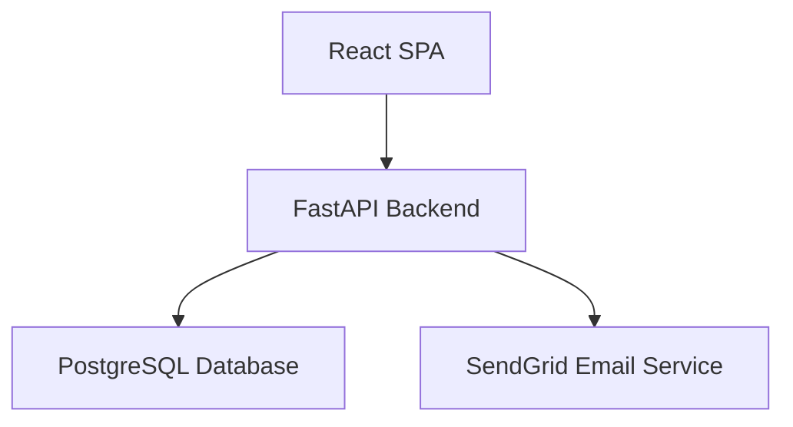
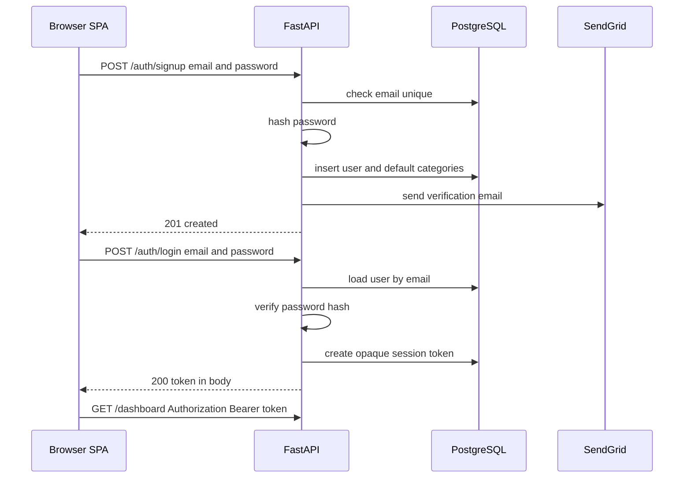
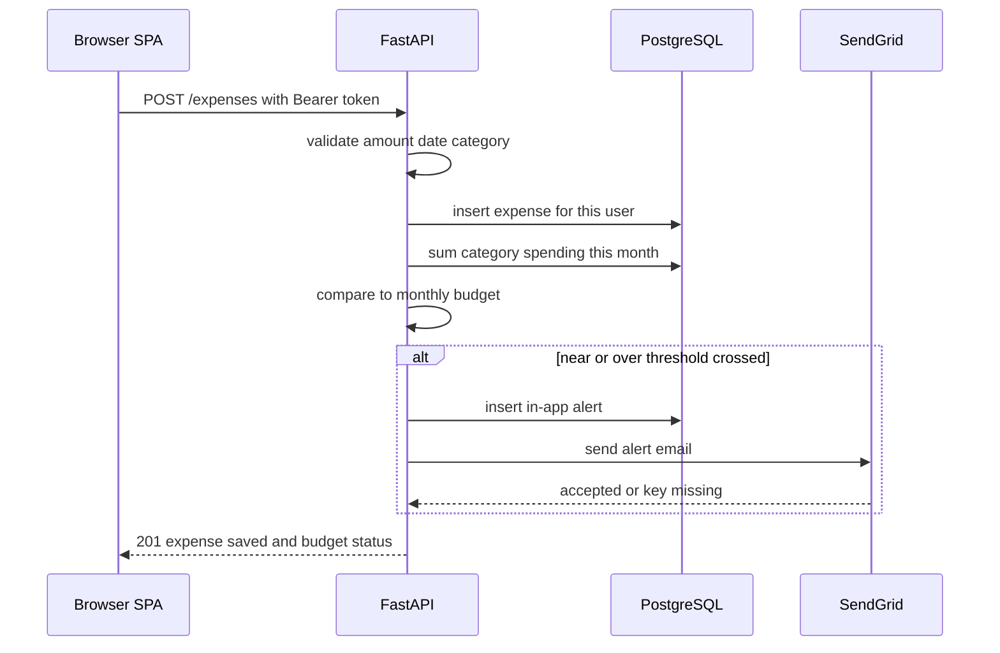
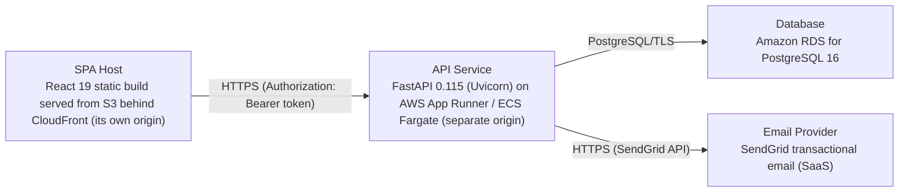

# Architecture

> Maintained by QuorQ AI SDLC. Text between `sdlc:auto` markers is regenerated; anything outside them is yours and is kept.

<!-- sdlc:auto:start narrative -->
## Overview

### ARCH-OVERVIEW · approved · source: architecture:summary

Expense Tracker is a lightweight, mobile-friendly responsive web app for individuals to privately track personal spending: manual expense logging, categorization, monthly per-category budgets, dashboard budget-vs-spend status, spending summary, and near-/over-budget alerts (in-app and email).

Approved architecture, version 1. Built on the approved stack: React 19 SPA frontend, FastAPI 0.115 backend, PostgreSQL 16 database, deployed on AWS, with SendGrid for transactional (verification and budget-alert) emails. Auth uses server-side sessions with an opaque bearer token because the SPA and API are served from separate origins. Users sign up with email/password, manage default and custom categories, set monthly per-category budgets, and view budget status and spending summary in their chosen account currency.

**Related:** COMP-WEB, COMP-API, COMP-DB, COMP-EMAIL

### COMP-WEB · approved · source: architecture:components:web

React 19 single-page application providing the entire responsive end-user UI.

Responsive web UI for sign-up/sign-in, expense entry and list with search/filter, category management, monthly budgets, dashboard budget status, spending summary, in-app alerts, currency selection, and CSV export. Stores the opaque session token client-side and sends it as an Authorization: Bearer header on every API call.

**Related:** COMP-API

### COMP-API · approved · source: architecture:components:api

FastAPI 0.115 REST backend handling all business logic, auth, and data access.

Handles authentication and server-side sessions, per-account data isolation, expense CRUD, category CRUD, monthly budgets, budget/spending aggregation, near-/over-budget evaluation, in-app alert records, CSV export, and triggering email alerts. Validates amounts, dates, and categories on input (via Pydantic).

**Related:** COMP-DB, COMP-EMAIL, COMP-WEB

### COMP-DB · approved · source: architecture:components:db

PostgreSQL 16 database providing durable, per-account-isolated storage and aggregation.

Durable storage of users, sessions, categories, expenses, budgets, and alerts. Performs per-category per-month spending totals that drive budget status, the summary, and alert thresholds. Each account's data is kept separate.

**Related:** COMP-API

### COMP-EMAIL · approved · source: architecture:components:email

SendGrid transactional email service for verification and budget-alert emails.

Delivers sign-up/verification messages and near-/over-budget alert emails to the account email address. Triggered by the API component.

**Related:** COMP-API

### PATH-SIGNUP-SIGNIN · approved · source: architecture:critical_paths:signup_signin

Critical path for new-user registration and returning-user sign-in.

New user registers with a unique, valid email and a password meeting minimum requirements; password is stored only as a hash. Login verifies credentials and issues an opaque session token returned in the response body; the SPA stores it and sends it as a bearer token on subsequent calls. A wrong email or password always returns one generic invalid-credentials message (no detail on which field was wrong).

**Related:** COMP-WEB, COMP-API, COMP-DB

### PATH-EXPENSE-ALERT · approved · source: architecture:critical_paths:log_expense_alert

Critical path for logging an expense and evaluating budget alerts.

A signed-in user saves a validated positive expense (amount, category, date). The API persists it, recalculates the category's spending for that month, and compares it against the monthly budget. When the near- or over-budget threshold is crossed, an in-app alert is recorded and an email is sent via SendGrid. If the SendGrid API key is missing, the in-app alert still persists and the missing-configuration condition is surfaced to operators (email delivery degrades gracefully rather than blocking the core flow).

**Related:** COMP-WEB, COMP-API, COMP-DB, COMP-EMAIL

### DATA-MODEL · approved · source: architecture:entities

Relational data model covering users, sessions, categories, expenses, budgets, and alerts.

users: id, email, password_hash, currency_code, email_verified, created_at. sessions: token, user_id, created_at, expires_at, revoked_at. categories: id, user_id, name, is_default, created_at. expenses: id, user_id, category_id, amount, spent_on, note, created_at. budgets: id, user_id, category_id, monthly_amount, created_at, updated_at. alerts: id, user_id, category_id, period_month, status, email_sent, is_read, created_at. All user-owned tables scope rows by user_id to keep each account's data isolated.

**Related:** COMP-DB, COMP-API

### API-DESIGN · approved · source: architecture:endpoints

REST API surface covering auth, profile/currency, categories, expenses, budgets, dashboard/summary, and alerts.

Auth: POST /auth/signup (unique email, min-strength password, seeds default categories, sends verification email); POST /auth/login (generic error on failure, returns opaque session token in body); POST /auth/logout (revokes current session token). Profile: GET /me (profile + account currency); PATCH /me/currency (set display currency). Categories: GET /categories; POST /categories (non-blank, non-duplicate name); PATCH /categories/{id} (rename, non-duplicate); DELETE /categories/{id} (custom only, requires confirm flag if used by existing expenses). Expenses: GET /expenses (recent-first, filterable by category and date range); POST /expenses (validated, triggers budget evaluation); PATCH /expenses/{id} (update amount/category/date, re-evaluates budget status); DELETE /expenses/{id} (removes from budgets/summary); GET /expenses/export (CSV of amount, category, date). Budgets: GET /budgets; PUT /budgets/{category_id} (set/update positive monthly budget); DELETE /budgets/{category_id} (removes status and alert generation). Dashboard/Summary: GET /dashboard (current-month budget-vs-spend per category: under/near/over; unbudgeted categories show spending only); GET /summary (total and per-category spend for selected month in account currency). Alerts: GET /alerts (list in-app alerts); POST /alerts/{id}/read (mark read).

**Related:** COMP-API, DATA-MODEL

### DEPLOY-TOPOLOGY · approved · source: architecture:deployment_nodes

AWS deployment topology with the SPA and API on separate origins, a managed database, and an external email SaaS.

SPA Host: React 19 static build served from S3 behind CloudFront, its own origin, static assets. API Service: FastAPI 0.115 (Uvicorn) on AWS App Runner / ECS Fargate, a separate origin, running in a Python 3.12 container. Database: Amazon RDS for PostgreSQL 16. Email Provider: SendGrid transactional email, external SaaS API. The SPA/API origin split is the reason auth uses a bearer token rather than cookies.

**Related:** COMP-WEB, COMP-API, COMP-DB, COMP-EMAIL

### TECH-FRONTEND · approved · source: architecture:technology_decisions:frontend

React 19 chosen for the frontend SPA over Vue and Svelte.

Approved stack. React 19 builds the interactive form-and-list screens -- expense entry, filterable list, budget forms, and a live-updating dashboard/summary -- plus a responsive, mobile-friendly layout. Delivered as a Vite SPA on its own origin, reading the API base URL from VITE_API_BASE_URL. Alternatives considered: Vue, Svelte.

**Related:** COMP-WEB

### TECH-BACKEND · approved · source: architecture:technology_decisions:backend

FastAPI 0.115 chosen for the backend over Django REST Framework and Flask.

Approved stack. FastAPI 0.115 with Pydantic validation keeps amounts, dates, and categories well-formed on input and cleanly implements auth, expense/category/budget CRUD, monthly aggregation, budget evaluation, and CSV export with little ceremony. Alternatives considered: Django REST Framework, Flask.

**Related:** COMP-API

### TECH-DATABASE · approved · source: architecture:technology_decisions:database

PostgreSQL 16 chosen for the database over MySQL and SQLite.

Approved stack. All data is structured and related -- users, categories, expenses, budgets. PostgreSQL 16 sums spending per category per month exactly with numeric types, powers list filtering and the summary, and keeps each account's data isolated. Filtering and aggregation stay inside PostgreSQL, so no separate search service is needed. Alternatives considered: MySQL, SQLite.

**Related:** COMP-DB, DATA-MODEL

### TECH-CLOUD · approved · source: architecture:technology_decisions:cloud

AWS chosen as the cloud provider over Google Cloud and Azure.

Approved stack. AWS hosts the static SPA (S3/CloudFront), the FastAPI container (App Runner/ECS), and the database (RDS PostgreSQL 16) with small-usage tiers suited to a free app, plus TLS and encryption at rest for financial data. Alternatives considered: Google Cloud, Azure.

**Related:** DEPLOY-TOPOLOGY, COMP-WEB, COMP-API, COMP-DB
<!-- sdlc:auto:end narrative -->

<!-- sdlc:auto:start building-blocks -->
## Building Block View

| ID | Name | Technology | Responsibility | Depends on |
|---|---|---|---|---|
| web | React SPA | React 19 | Responsive web UI for sign-up/sign-in, expense entry and list with search/filter, category management, monthly budgets, dashboard budget status, spending summary, in-app alerts, currency selection and CSV export. Stores the opaque session token and sends it as Authorization: Bearer on every API call. | api |
| api | FastAPI Backend | FastAPI 0.115 | REST API handling authentication and server-side sessions, per-account data isolation, expense CRUD, category CRUD, monthly budgets, budget/spending aggregation, near-/over-budget evaluation, in-app alert records, CSV export and triggering email alerts. Validates amounts, dates and categories on input. | db, email |
| db | PostgreSQL Database | PostgreSQL 16 | Durable storage of users, sessions, categories, expenses, budgets and alerts. Performs per-category per-month spending totals that drive budget status, the summary and alert thresholds, with each account's data kept separate. | — |
| email | SendGrid Email Service | SendGrid | Transactional email delivery for sign-up/verification messages and near-/over-budget alert emails sent to the account email address. | — |

<!-- sdlc:auto:end building-blocks -->

<!-- sdlc:auto:start runtime -->
## Runtime View

### Sign up and sign in

New user registers with a unique, valid email and a password meeting minimum requirements; password is stored only as a hash. Login verifies credentials and issues an opaque session token returned in the response body; the SPA stores it and sends it as a bearer token. Wrong email or password returns one generic invalid-credentials message.

- **Components:** web, api, db, email
- **Modules:** auth.router, auth.service, auth.security, sessions.repository, users.repository
- **Key functions:** sign_up(email, password), hash_password(password), verify_password(password, hash), sign_in(email, password), create_session(user_id), get_current_user(bearer_token), sign_out(bearer_token), seed_default_categories(user_id)

### Log expense and evaluate budget alerts

A signed-in user saves a validated positive expense (amount, category, date). The API persists it, recalculates the category's spending for that month, compares it against the monthly budget, and when the near- or over-budget threshold is crossed records an in-app alert and sends an email via SendGrid. If the email key is missing the in-app alert still persists and the missing-config condition is surfaced to operators.

- **Components:** web, api, db, email
- **Modules:** expenses.router, expenses.service, budgets.service, alerts.service, email.client
- **Key functions:** create_expense(user_id, amount, category_id, date), validate_expense(payload), month_spending(user_id, category_id, month), evaluate_budget(user_id, category_id, month), record_in_app_alert(user_id, category_id, status), send_budget_email(user_email, category, status)

<!-- sdlc:auto:end runtime -->

<!-- sdlc:auto:start deployment-view -->
## Deployment View

| Name | Service | Runtime | Scaling | Environment |
|---|---|---|---|---|
| SPA Host | React 19 static build served from S3 behind CloudFront (its own origin) | Static assets | CDN edge cache | dev |
| API Service | FastAPI 0.115 (Uvicorn) on AWS App Runner / ECS Fargate (separate origin) | Python 3.12 container | 1 instance in dev, horizontal scale later | dev |
| Database | Amazon RDS for PostgreSQL 16 | PostgreSQL 16 | Single db.t-class instance, encrypted at rest | dev |
| Email Provider | SendGrid transactional email (SaaS) | External API | Managed by provider | dev |

| Source | Target | Protocol |
|---|---|---|
| SPA Host | API Service | HTTPS (Authorization: Bearer token) |
| API Service | Database | PostgreSQL/TLS |
| API Service | Email Provider | HTTPS (SendGrid API) |

<!-- sdlc:auto:end deployment-view -->

<!-- sdlc:auto:start decisions -->
## Architecture Decisions

| Layer | Choice | ADR |
|---|---|---|
| Frontend | React 19 | [ADR-0001](adr/frontend.md) |
| Backend | FastAPI 0.115 | [ADR-0002](adr/backend.md) |
| Database | PostgreSQL 16 | [ADR-0003](adr/database.md) |
| Cloud | AWS | [ADR-0004](adr/cloud.md) |
<!-- sdlc:auto:end decisions -->

<!-- sdlc:auto:start links -->
## Related Documents

- [Data Model](data-model.md)
- [API Specification](api/openapi.yaml)
- [Architecture Decision Records](adr/README.md)
<!-- sdlc:auto:end links -->
