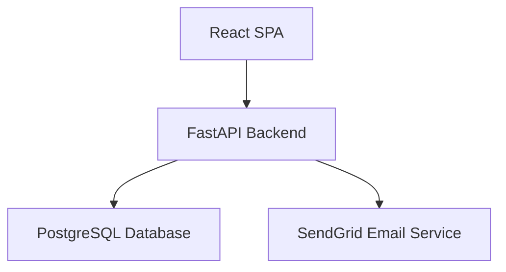
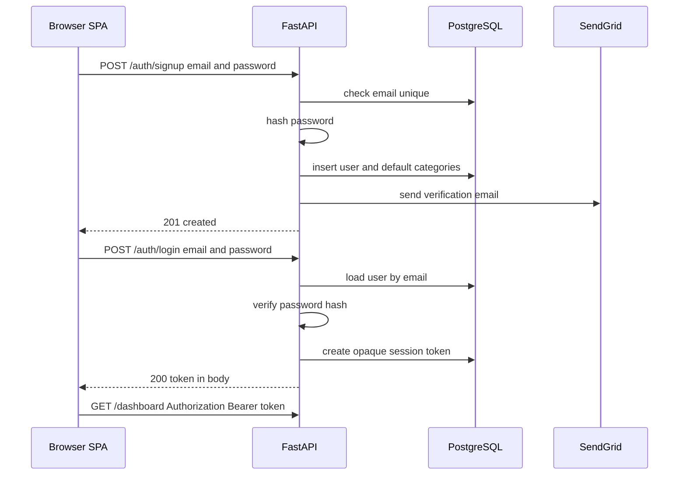
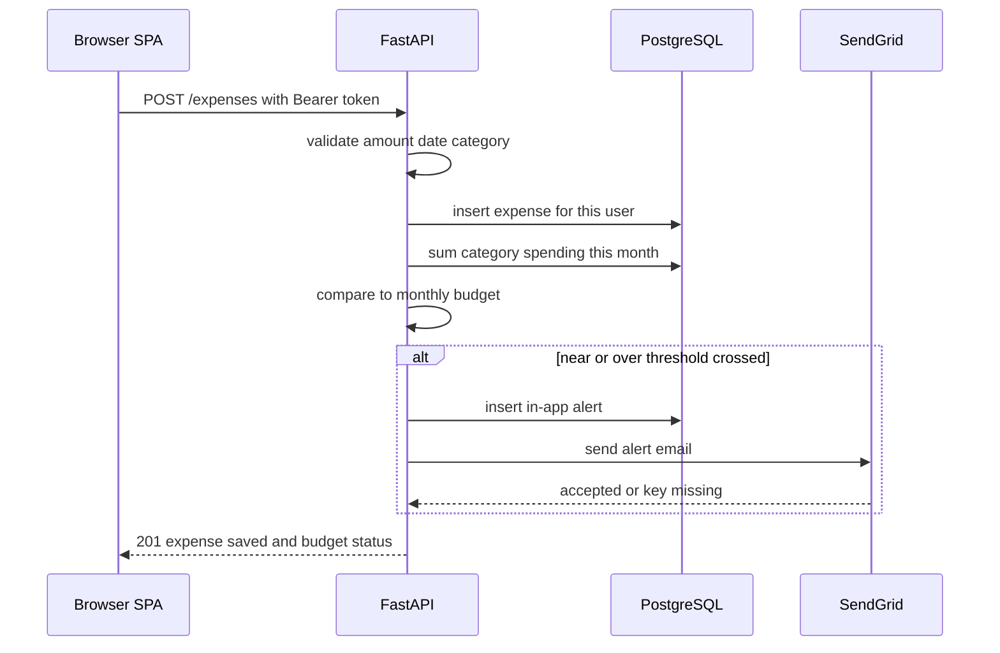
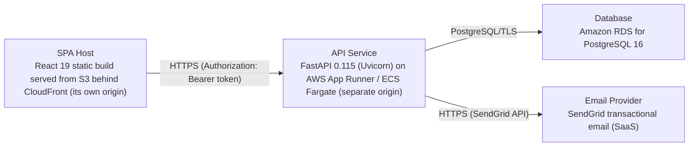

# Architecture

> Maintained by QuorQ AI SDLC. Text between `sdlc:auto` markers is regenerated; anything outside them is yours and is kept.

<!-- sdlc:auto:start narrative -->
## Overview

### ARCH-OVERVIEW · approved · source: architecture:summary

Expense Tracker is a lightweight, mobile-friendly responsive web app for private personal spending tracking, built on the approved stack (React 19 SPA, FastAPI 0.115, PostgreSQL 16, AWS, SendGrid).

Users sign up with email/password, log manual expenses (amount, category, date), organize them under default and custom categories, set monthly per-category budgets, and view budget-vs-spending status plus a spending summary on a dashboard in their chosen account currency. Near-/over-budget thresholds trigger in-app and email alerts. Auth uses server-side sessions with an opaque bearer token because the SPA and API are served from separate origins.

**Related:** REQ-TECH-STACK, REQ-SERVICES

### ARCH-COMP-WEB · approved · source: architecture:component:web

React SPA (React 19) delivers the responsive UI for sign-up/sign-in, expense entry/list with search/filter, category management, budgets, dashboard, summary, in-app alerts, currency selection and CSV export.

Stores the opaque session token client-side and sends it as an Authorization: Bearer header on every API call.

**Related:** REQ-FEAT-EXPENSES, REQ-FEAT-CATEGORIES, REQ-FEAT-BUDGETS, REQ-FEAT-DASHBOARD, REQ-FEAT-SETTINGS

### ARCH-COMP-API · approved · source: architecture:component:api

FastAPI backend handles authentication/sessions, per-account data isolation, expense/category/budget CRUD, budget-vs-spending aggregation, near-/over-budget evaluation, in-app alert records, CSV export, and triggering email alerts.

Validates amounts, dates and categories on input (Pydantic).

**Related:** REQ-FEAT-AUTH, REQ-FEAT-EXPENSES, REQ-FEAT-CATEGORIES, REQ-FEAT-BUDGETS, REQ-FEAT-ALERTS, REQ-FEAT-SETTINGS

### ARCH-COMP-DB · approved · source: architecture:component:db

PostgreSQL 16 database durably stores users, sessions, categories, expenses, budgets and alerts.

Performs per-category per-month spending totals that drive budget status, the summary, and alert thresholds, keeping each account's data separate.

**Related:** REQ-TECH-STACK

### ARCH-COMP-EMAIL · approved · source: architecture:component:email

SendGrid provides transactional email delivery for sign-up/verification messages and near-/over-budget alert emails sent to the account email address.

External SaaS dependency requiring SENDGRID_API_KEY.

**Related:** REQ-SERVICES, REQ-FEAT-ALERTS, REQ-NFR-006

### ARCH-PATH-AUTH · approved · source: architecture:critical-path:Sign up and sign in

New user registers with a unique, valid email and a password meeting minimum requirements; password is stored only as a hash.

Login verifies credentials and issues an opaque session token returned in the response body; the SPA stores it and sends it as a bearer token. Wrong email or password returns one generic invalid-credentials message.

**Related:** EPIC-001, US-001, US-002, REQ-NFR-001, REQ-NFR-002

### ARCH-PATH-EXPENSE-ALERT · approved · source: architecture:critical-path:Log expense and evaluate budget alerts

A signed-in user saves a validated positive expense; the API persists it, recalculates the category's monthly spending, and compares it against the budget.

When the near- or over-budget threshold is crossed, the API records an in-app alert and sends an email via SendGrid. If the email key is missing, the in-app alert still persists and the missing-config condition is surfaced to operators.

**Related:** EPIC-002, EPIC-006, US-005, US-016, US-017, REQ-NFR-006

### ARCH-DATA-MODEL · approved · source: architecture:entities

Six entities model users, sessions, categories, expenses, budgets and alerts.

- users: id, email, password_hash, currency_code, email_verified, created_at.
- sessions: token, user_id, created_at, expires_at, revoked_at.
- categories: id, user_id, name, is_default, created_at.
- expenses: id, user_id, category_id, amount, spent_on, note, created_at.
- budgets: id, user_id, category_id, monthly_amount, created_at, updated_at.
- alerts: id, user_id, category_id, period_month, status, email_sent, is_read, created_at.

**Related:** ARCH-COMP-DB

### ARCH-EP-AUTH · approved · source: architecture:endpoints:auth

Authentication endpoints for signup, login and logout.

- POST /auth/signup - create account with unique email and password meeting minimum requirements; seeds default categories; sends verification email.
- POST /auth/login - verify credentials and issue an opaque session token in the body; generic error on failure.
- POST /auth/logout - revoke the current session token so it can no longer be used.

**Related:** US-001, US-002, US-003

### ARCH-EP-ACCOUNT · approved · source: architecture:endpoints:account

Account profile and currency endpoints.

- GET /me - return the signed-in user's profile and account currency.
- PATCH /me/currency - set the single account currency used to display all amounts.

**Related:** US-018

### ARCH-EP-CATEGORIES · approved · source: architecture:endpoints:categories

Category listing, creation, rename and deletion endpoints.

- GET /categories - list default and custom categories.
- POST /categories - create a custom category with non-blank, non-duplicate name.
- PATCH /categories/{id} - rename a custom category to a valid non-duplicate name.
- DELETE /categories/{id} - delete a custom category; requires confirm flag when used by existing expenses.

**Related:** US-008, US-009, US-010

### ARCH-EP-EXPENSES · approved · source: architecture:endpoints:expenses

Expense CRUD, listing/filtering and CSV export endpoints.

- GET /expenses - list recent-first, filterable by category and date range.
- POST /expenses - create a validated expense; triggers budget evaluation.
- PATCH /expenses/{id} - update amount/category/date; re-evaluates affected budget status.
- DELETE /expenses/{id} - delete so it no longer counts toward budgets or summary.
- GET /expenses/export - export the signed-in user's expenses as CSV of amount, category and date.

**Related:** US-005, US-006, US-007, US-019, US-020, US-021

### ARCH-EP-BUDGETS · approved · source: architecture:endpoints:budgets

Budget listing, setting and removal endpoints.

- GET /budgets - list the user's category monthly budgets.
- PUT /budgets/{category_id} - set or update a positive monthly budget for a category.
- DELETE /budgets/{category_id} - remove a category budget so it stops showing status and generating alerts.

**Related:** US-011, US-012

### ARCH-EP-DASHBOARD-SUMMARY · approved · source: architecture:endpoints:dashboard-summary

Dashboard status and spending summary endpoints.

- GET /dashboard - budget-vs-spending status for the current month per category (budget, spent, under/near/over); unbudgeted categories show spending only.
- GET /summary - total spending and per-category breakdown for the selected month in account currency.

**Related:** US-013, US-014

### ARCH-EP-ALERTS · approved · source: architecture:endpoints:alerts

In-app alert listing and read-marking endpoints.

- GET /alerts - list in-app near-/over-budget alerts for the signed-in user.
- POST /alerts/{id}/read - mark an in-app alert as read.

**Related:** US-016

### ARCH-DEPLOY-SPA · approved · source: architecture:deployment-node:SPA Host

React 19 static build served from S3 behind CloudFront, on its own origin.

Deployment node type: Static assets.

**Related:** ARCH-COMP-WEB

### ARCH-DEPLOY-API · approved · source: architecture:deployment-node:API Service

FastAPI 0.115 (Uvicorn) runs on AWS App Runner / ECS Fargate, on a separate origin from the SPA.

Deployment node type: Python 3.12 container.

**Related:** ARCH-COMP-API

### ARCH-DEPLOY-DB · approved · source: architecture:deployment-node:Database

Amazon RDS for PostgreSQL 16 hosts the database.

Deployment node type: PostgreSQL 16.

**Related:** ARCH-COMP-DB

### ARCH-DEPLOY-EMAIL · approved · source: architecture:deployment-node:Email Provider

SendGrid transactional email is used as an external SaaS API.

Deployment node type: External API.

**Related:** ARCH-COMP-EMAIL

### ARCH-TECH-FRONTEND · approved · source: architecture:technology-decision:Frontend

React 19 chosen over Vue/Svelte for the interactive form-and-list screens and responsive layout.

Delivered as a Vite SPA on its own origin, reading the API base URL from VITE_API_BASE_URL.

**Related:** ARCH-COMP-WEB

### ARCH-TECH-BACKEND · approved · source: architecture:technology-decision:Backend

FastAPI 0.115 chosen over Django REST Framework/Flask for Pydantic-validated auth, CRUD, aggregation, budget evaluation and CSV export with little ceremony.

Keeps amounts, dates and categories well-formed on input.

**Related:** ARCH-COMP-API

### ARCH-TECH-DATABASE · approved · source: architecture:technology-decision:Database

PostgreSQL 16 chosen over MySQL/SQLite because all data is structured and related; numeric types sum spending exactly and keep accounts isolated.

Filtering and aggregation stay inside PostgreSQL, so no separate search service is needed.

**Related:** ARCH-COMP-DB

### ARCH-TECH-CLOUD · approved · source: architecture:technology-decision:Cloud

AWS chosen over Google Cloud/Azure to host the static SPA (S3/CloudFront), FastAPI container (App Runner/ECS) and database (RDS PostgreSQL 16).

Small-usage tiers suited to a free app, plus TLS and encryption at rest for financial data.

**Related:** ARCH-DEPLOY-SPA, ARCH-DEPLOY-API, ARCH-DEPLOY-DB
<!-- sdlc:auto:end narrative -->

<!-- sdlc:auto:start building-blocks -->
## Building Block View

| ID | Name | Technology | Responsibility | Depends on |
|---|---|---|---|---|
| web | React SPA | React 19 | Responsive web UI for sign-up/sign-in, expense entry and list with search/filter, category management, monthly budgets, dashboard budget status, spending summary, in-app alerts, currency selection and CSV export. Stores the opaque session token and sends it as Authorization: Bearer on every API call. | api |
| api | FastAPI Backend | FastAPI 0.115 | REST API handling authentication and server-side sessions, per-account data isolation, expense CRUD, category CRUD, monthly budgets, budget/spending aggregation, near-/over-budget evaluation, in-app alert records, CSV export and triggering email alerts. Validates amounts, dates and categories on input. | db, email |
| db | PostgreSQL Database | PostgreSQL 16 | Durable storage of users, sessions, categories, expenses, budgets and alerts. Performs per-category per-month spending totals that drive budget status, the summary and alert thresholds, with each account's data kept separate. | — |
| email | SendGrid Email Service | SendGrid | Transactional email delivery for sign-up/verification messages and near-/over-budget alert emails sent to the account email address. | — |

<!-- sdlc:auto:end building-blocks -->

<!-- sdlc:auto:start runtime -->
## Runtime View

### Sign up and sign in

New user registers with a unique, valid email and a password meeting minimum requirements; password is stored only as a hash. Login verifies credentials and issues an opaque session token returned in the response body; the SPA stores it and sends it as a bearer token. Wrong email or password returns one generic invalid-credentials message.

- **Components:** web, api, db, email
- **Modules:** auth.router, auth.service, auth.security, sessions.repository, users.repository
- **Key functions:** sign_up(email, password), hash_password(password), verify_password(password, hash), sign_in(email, password), create_session(user_id), get_current_user(bearer_token), sign_out(bearer_token), seed_default_categories(user_id)

### Log expense and evaluate budget alerts

A signed-in user saves a validated positive expense (amount, category, date). The API persists it, recalculates the category's spending for that month, compares it against the monthly budget, and when the near- or over-budget threshold is crossed records an in-app alert and sends an email via SendGrid. If the email key is missing the in-app alert still persists and the missing-config condition is surfaced to operators.

- **Components:** web, api, db, email
- **Modules:** expenses.router, expenses.service, budgets.service, alerts.service, email.client
- **Key functions:** create_expense(user_id, amount, category_id, date), validate_expense(payload), month_spending(user_id, category_id, month), evaluate_budget(user_id, category_id, month), record_in_app_alert(user_id, category_id, status), send_budget_email(user_email, category, status)

<!-- sdlc:auto:end runtime -->

<!-- sdlc:auto:start deployment-view -->
## Deployment View

| Name | Service | Runtime | Scaling | Environment |
|---|---|---|---|---|
| SPA Host | React 19 static build served from S3 behind CloudFront (its own origin) | Static assets | CDN edge cache | dev |
| API Service | FastAPI 0.115 (Uvicorn) on AWS App Runner / ECS Fargate (separate origin) | Python 3.12 container | 1 instance in dev, horizontal scale later | dev |
| Database | Amazon RDS for PostgreSQL 16 | PostgreSQL 16 | Single db.t-class instance, encrypted at rest | dev |
| Email Provider | SendGrid transactional email (SaaS) | External API | Managed by provider | dev |

| Source | Target | Protocol |
|---|---|---|
| SPA Host | API Service | HTTPS (Authorization: Bearer token) |
| API Service | Database | PostgreSQL/TLS |
| API Service | Email Provider | HTTPS (SendGrid API) |

<!-- sdlc:auto:end deployment-view -->

<!-- sdlc:auto:start decisions -->
## Architecture Decisions

| Layer | Choice | ADR |
|---|---|---|
| Frontend | React 19 | [ADR-0001](adr/frontend.md) |
| Backend | FastAPI 0.115 | [ADR-0002](adr/backend.md) |
| Database | PostgreSQL 16 | [ADR-0003](adr/database.md) |
| Cloud | AWS | [ADR-0004](adr/cloud.md) |
<!-- sdlc:auto:end decisions -->

<!-- sdlc:auto:start links -->
## Related Documents

- [Data Model](data-model.md)
- [API Specification](api/openapi.yaml)
- [Architecture Decision Records](adr/README.md)
<!-- sdlc:auto:end links -->
