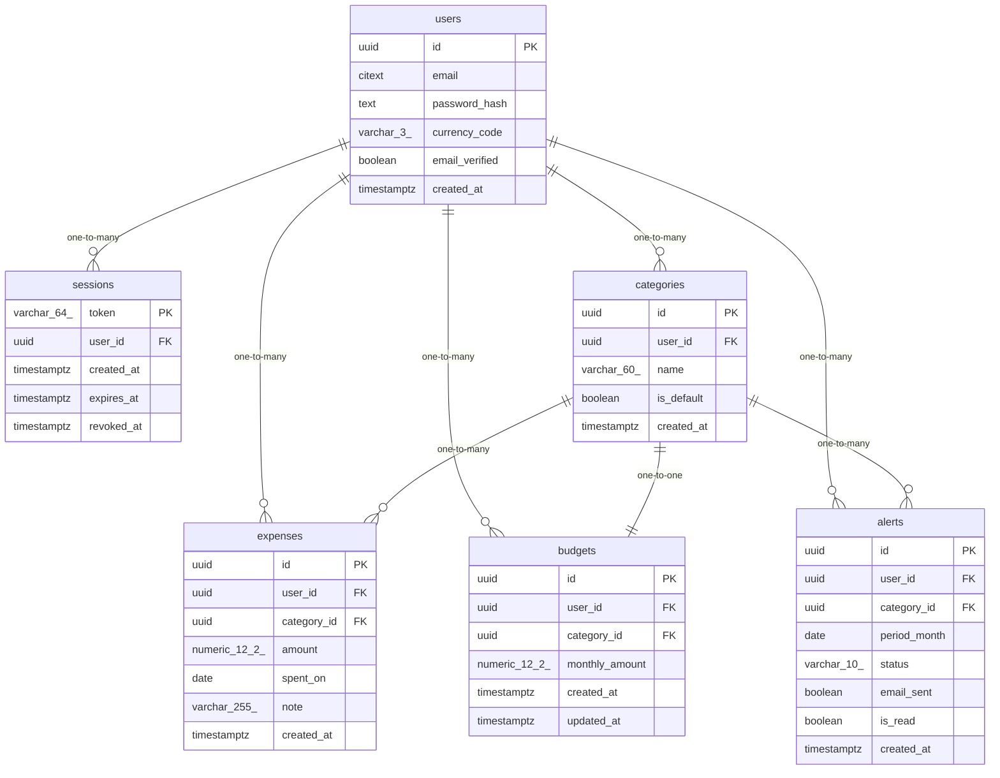

# Data Model

<!-- sdlc:auto:start entities -->
### users

| Field | Type | PK | FK | Nullable |
|---|---|---|---|---|
| id | uuid | True | — | False |
| email | citext | False | — | False |
| password_hash | text | False | — | False |
| currency_code | varchar(3) | False | — | False |
| email_verified | boolean | False | — | False |
| created_at | timestamptz | False | — | False |

### sessions

| Field | Type | PK | FK | Nullable |
|---|---|---|---|---|
| token | varchar(64) | True | — | False |
| user_id | uuid | False | users.id | False |
| created_at | timestamptz | False | — | False |
| expires_at | timestamptz | False | — | False |
| revoked_at | timestamptz | False | — | True |

### categories

| Field | Type | PK | FK | Nullable |
|---|---|---|---|---|
| id | uuid | True | — | False |
| user_id | uuid | False | users.id | False |
| name | varchar(60) | False | — | False |
| is_default | boolean | False | — | False |
| created_at | timestamptz | False | — | False |

### expenses

| Field | Type | PK | FK | Nullable |
|---|---|---|---|---|
| id | uuid | True | — | False |
| user_id | uuid | False | users.id | False |
| category_id | uuid | False | categories.id | False |
| amount | numeric(12,2) | False | — | False |
| spent_on | date | False | — | False |
| note | varchar(255) | False | — | True |
| created_at | timestamptz | False | — | False |

### budgets

| Field | Type | PK | FK | Nullable |
|---|---|---|---|---|
| id | uuid | True | — | False |
| user_id | uuid | False | users.id | False |
| category_id | uuid | False | categories.id | False |
| monthly_amount | numeric(12,2) | False | — | False |
| created_at | timestamptz | False | — | False |
| updated_at | timestamptz | False | — | False |

### alerts

| Field | Type | PK | FK | Nullable |
|---|---|---|---|---|
| id | uuid | True | — | False |
| user_id | uuid | False | users.id | False |
| category_id | uuid | False | categories.id | False |
| period_month | date | False | — | False |
| status | varchar(10) | False | — | False |
| email_sent | boolean | False | — | False |
| is_read | boolean | False | — | False |
| created_at | timestamptz | False | — | False |
<!-- sdlc:auto:end entities -->

<!-- sdlc:auto:start relationships -->
| Source | Target | Type |
|---|---|---|
| users | sessions | one-to-many |
| users | categories | one-to-many |
| users | expenses | one-to-many |
| users | budgets | one-to-many |
| users | alerts | one-to-many |
| categories | expenses | one-to-many |
| categories | budgets | one-to-one |
| categories | alerts | one-to-many |
<!-- sdlc:auto:end relationships -->

<!-- sdlc:auto:start er-diagram -->

<!-- sdlc:auto:end er-diagram -->
